<div align="center">

# MULTIVERSE // SIGNAL RUNNER

### A playable data-quality mission by Lokraj Joshi

[](https://lokrajjoshi.github.io/multiverse-signal-runner/)
[](https://github.com/Lokrajjoshi/multiverse-signal-runner/actions)
[](https://lokrajjoshi.github.io/multiverse-signal-runner/)

[](https://lokrajjoshi.github.io/multiverse-signal-runner/)

**Collect trusted signals. Validate anomalies. Restore the Bengaluru data grid.**

</div>

---

## Mission

Signal Runner turns Lokraj Joshi's technical identity into an interactive portfolio artifact. Pilot the **LJ Signal Drone** through a cinematic data grid, collect reliable records, validate anomalies, and recover failing systems while live telemetry tracks integrity, coverage, insight, and score.

## Why this project exists

This is a small, dependency-free demonstration of how data-quality thinking can become an engaging product experience:

- **Observe:** collect signals and monitor operational telemetry.
- **Validate:** identify anomalies through explicit domain rules.
- **Decide:** balance integrity, coverage, insight, and risk.
- **Deliver:** ship a tested browser experience through CI and GitHub Pages.

If the mission is useful for your learning, portfolio, or classroom project, explore it, open an issue with feedback, or star the repository to help others discover it.

## Controls

| Action | Keyboard | Touch |
|---|---|---|
| Navigate | `WASD` / arrow keys | Direction pad |
| Boost | Hold `Shift` | **Boost** button |
| Validate anomaly | `Space` | **Pulse** button |
| Pause / resume | `P` | Pause control |

## Technical breakdown

| Layer | Implementation | What it demonstrates |
|---|---|---|
| Architecture | Dependency-free ES modules, Canvas 2D renderer, deterministic domain engine | Separation of presentation, state, and business rules |
| Game logic | Mission progression, collision system, scoring, combo/rank model, validation pulse | Event-driven logic and state management |
| Analytics | Live integrity, coverage, insight, signal, and high-score telemetry | Metrics-first product thinking |
| Quality | Node's native test runner with focused domain tests | Testable rules without framework overhead |
| Delivery | GitHub Actions CI and GitHub Pages deployment | Automated verification and release workflow |
| Experience | Responsive keyboard and touch controls, reduced-motion support | Accessible, cross-device interaction design |

[Read the architecture note](docs/architecture.md) · [View the changelog and roadmap](CHANGELOG.md) · [Use the playtest checklist](docs/playtest-checklist.md)

## Skill map

- **Data & Business Analysis:** cleanse signal streams, surface insights, and monitor operational metrics.
- **Technical IT Operations:** protect system integrity and recover unstable services.
- **Automation & Quality:** validate anomalies and build coverage before release.
- **Full-Stack Engineering:** connect UI, domain logic, analytics, testing, and deployment.

## Run locally

```bash
npm test
npx serve .
```

Then open the local URL shown by the static server. No build step or runtime dependencies are required.

## Feedback loop

Found a bug, accessibility issue, confusing mechanic, or useful enhancement?

- [Open an issue](https://github.com/Lokrajjoshi/multiverse-signal-runner/issues/new/choose)
- [Review the open work](https://github.com/Lokrajjoshi/multiverse-signal-runner/issues)
- [Play the live mission](https://lokrajjoshi.github.io/multiverse-signal-runner/)

Please include your device, browser, reproduction steps, and expected behavior so the next iteration can be evidence-led.

---

<div align="center">

Designed and engineered by **Lokraj Joshi** · Bengaluru, India

</div>


## Accessibility & QA protocol

The mission is designed to remain readable and playable across input modes:

- **Keyboard:** every core action has a keyboard equivalent and visible focus treatment.
- **Touch:** navigation, boost, validation, and pause controls expose clear labels.
- **Motion:** reduced-motion preferences are respected without removing mission feedback.
- **Validation:** domain rules are covered by the native Node.js test runner before deployment.

Before opening a release PR:

```bash
npm test
```

QA target: **playable · understandable · testable · deployable**.
