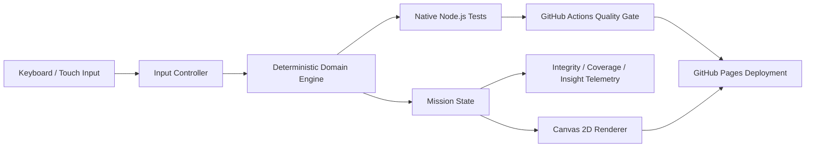

# Architecture

Signal Runner separates the playable interface from the rules that make the mission testable.

## Runtime boundaries

| Boundary | Responsibility |
|---|---|
| Input controller | Normalizes keyboard and touch actions into domain events |
| Domain engine | Owns mission progression, collisions, validation, scoring, combo, and rank |
| Mission state | Holds the current player, signals, hazards, objectives, and telemetry |
| Renderer | Turns state into the responsive Canvas 2D experience |
| Telemetry | Exposes user-facing integrity, coverage, insight, signal, combo, and score |
| Test suite | Exercises domain rules without requiring a browser |
| CI and Pages | Validates the repository and publishes the static experience |

## Design principles

- **Deterministic rules:** domain behavior should be reproducible and testable.
- **Small surface area:** the game runs without a framework or runtime dependency.
- **Evidence-led iteration:** playtest feedback should become a focused issue or test.
- **Accessible interaction:** keyboard, touch, visible focus, and reduced motion remain first-class concerns.
